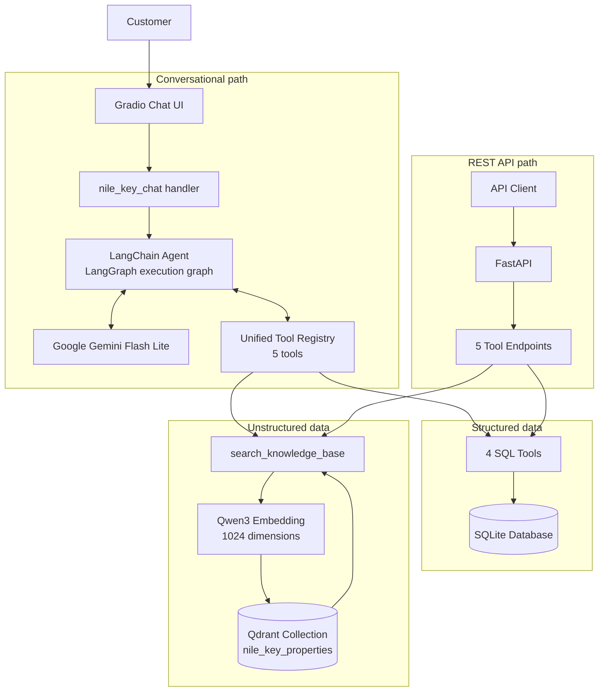
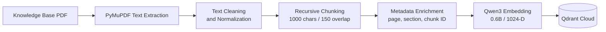
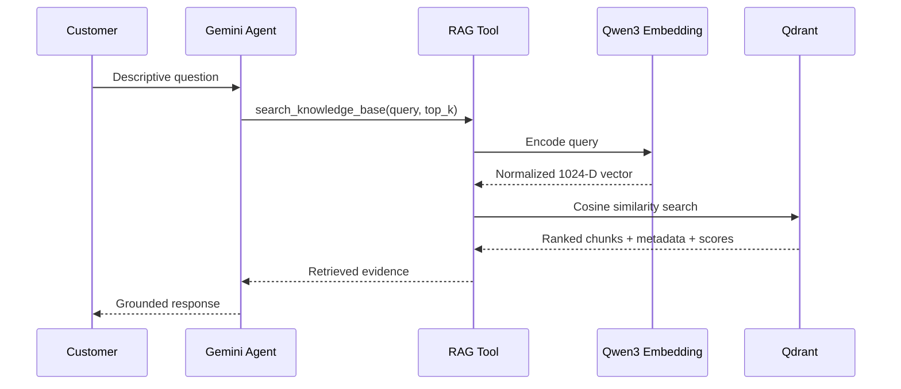
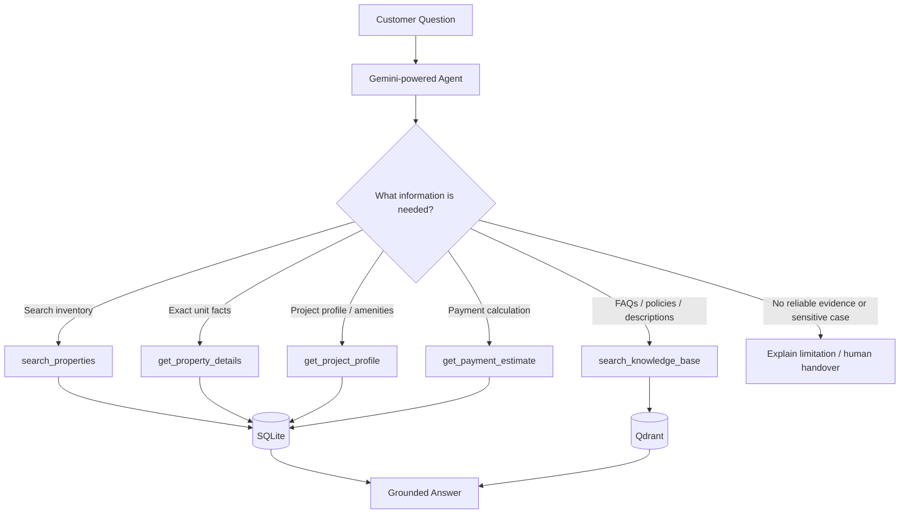
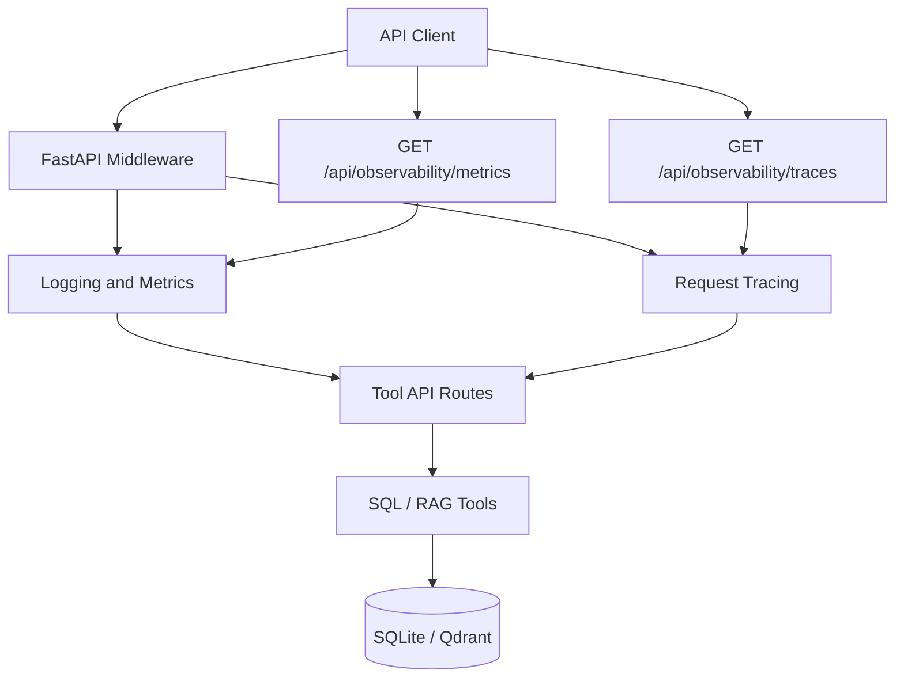

# Real_Estate_GenAI_Agent
Nile Key Properties — GenAI Real Estate Assistant

  
  
  
  
  
  
  

A bilingual (Arabic/English) real-estate assistant prototype that combines structured SQL tools, Retrieval-Augmented Generation (RAG), and a tool-calling AI agent to answer property, project, and payment questions using a fictional training dataset.
Dataset notice: Nile Key Properties is a fictional training and evaluation project. Its properties, prices, projects, and payment plans are not real commercial offers or verified market data.

Table of Contents
- Project Overview
- What It Can Do
- Technology Stack
- System Architecture
- RAG Pipeline
- Agent Tool Routing
- FastAPI and Observability
- Data and Knowledge Base
- Evaluation Results
- GenAI Lifecycle Status
- Repository Structure
- Run the Notebook
- API Endpoints
- Security Notes
- Known Limitations and Next Steps
Project Overview
The project demonstrates a practical GenAI workflow for real-estate assistance:
1. Retrieve exact unit facts from SQLite through parameterized SQL tools.
2. Retrieve descriptive knowledge from a PDF through semantic search in Qdrant.
3. Let a Gemini-powered LangChain agent select and invoke the appropriate tool.
4. Expose the structured-data and RAG tools through FastAPI.
5. Provide a Gradio chat interface in the Colab notebook.
6. Record API metrics and request traces for basic observability.
The central design principle is source-aware answering:
- SQLite is authoritative for exact unit-level facts such as price, area, bedrooms, and availability.
- The PDF knowledge base is used for descriptive project information, FAQs, policies, and sales procedures.
- Payment calculations are performed by deterministic Python logic using verified SQLite records.
- The assistant must not invent missing facts and should hand over unverified, contractual, legal, or disputed matters to a human representative.
What It Can Do
Capability	Implementation
Property search	SQL tool with city, project, type, bedrooms, area, price, and availability filters
Property details	Retrieve a complete unit record by property ID
Project profile	Retrieve project information and registered amenities
Payment estimate	Calculate down payment, remaining balance, and installments
Knowledge search	Semantic retrieval over PDF chunks using Qdrant
Bilingual interaction	Arabic and English prompts and queries
Tool selection	LangChain agent with five registered tools
API access	FastAPI endpoints for the five tools
Chat UI	Gradio Blocks interface in the notebook
Monitoring	Request counts, status counts, errors, and average latency
Tracing	Trace ID, span ID, parent span ID, duration, and recent trace inspection

Technology Stack
Layer	Technology
Notebook environment	Google Colab
LLM	Google Gemini Flash Lite (configured in the notebook)
Agent framework	LangChain / LangGraph-backed agent
Embeddings	Qwen/Qwen3-Embedding-0.6B via Sentence Transformers
Vector database	Qdrant Cloud
Structured database	SQLite
Document processing	PyMuPDF
API	FastAPI + Uvicorn + Pydantic
User interface	Gradio
Data processing	Python, Pandas, NumPy
Retrieval experiment	Dense search + BM25 + Reciprocal Rank Fusion (RRF)

System Architecture
The notebook contains two access paths: a Gradio chat path that invokes the agent, and a FastAPI path that exposes the registered tools.

Architecture Notes
- The Gradio handler calls the existing nile_key_chat function, which invokes the current agent.
- The agent has four SQLite tools and one Qdrant RAG tool.
- FastAPI exposes the five tools as REST endpoints.
- The uploaded notebook source implements the Gradio UI. A separate Streamlit health check was recorded in the Colab runtime, but a standalone Streamlit source file was not part of the uploaded source set; this repository therefore includes Gradio as the implemented UI.
- The notebook's FastAPI source defines five tool POST routes. A dedicated /api/agent/chat route is not declared in the source snapshot packaged here.
RAG Pipeline
Document Ingestion

Query-Time Retrieval

Retrieval Configuration
Setting	Value
Embedding model	Qwen/Qwen3-Embedding-0.6B
Embedding dimension	1024
Vector collection	nile_key_properties
Distance metric	Cosine
Stored points at verification	27
Chunk size	1000 characters
Chunk overlap	150 characters
Retrieval default	Top 5

The notebook also inspects the Qdrant HNSW configuration. With only 27 stored vectors and a configured full-scan threshold of 10,000, full scan is expected for the current small collection.
Agent Tool Routing

Registered Tools
Tool	Data source	Purpose
search_properties	SQLite	Filter and search units
get_property_details	SQLite	Retrieve exact unit details
get_project_profile	SQLite	Retrieve project profile and amenities
get_payment_estimate	SQLite + Python	Deterministic payment calculation
search_knowledge_base	Qdrant	Retrieve descriptive PDF passages

FastAPI and Observability
API Request Flow

Verified API Routes
Method	Endpoint	Purpose
GET	/	API root
GET	/health	Health check
POST	/api/properties/search	Property search
POST	/api/properties/details	Property details
POST	/api/projects/profile	Project profile
POST	/api/payments/estimate	Payment estimate
POST	/api/knowledge/search	RAG knowledge search
GET	/api/observability/metrics	Runtime metrics
GET	/api/observability/traces	Recent request traces

Observability Features
Logging and Monitoring
- Request count.
- Error count for HTTP 5xx responses.
- HTTP status distribution.
- Request path counts.
- Average request latency.
Request Tracing
- Trace ID generation.
- Span ID generation.
- Parent span propagation using the W3C traceparent header format.
- Request duration and status recording.
- In-memory retention of the latest 100 traces.
The current metrics and traces are stored in process memory. Persistent metrics storage and an external tracing backend such as Jaeger or Grafana Tempo have not been configured.

Data and Knowledge Base
The packaged SQLite database contains:
Table / Entity	Count
Properties	500
Projects	10
Payment plans	500
Project amenities	39
Property features	2,375
Knowledge documents	88
Evaluation queries	86
Original V1 property rows	12
Synthetic property rows	488

All 10 project records are flagged as fictional. The 500 property rows consist of 12 preserved demo rows and 488 synthetic rows.

The accompanying PDF is a 12-page fictional knowledge base containing project descriptions, policies, FAQs, sales procedures, and evaluation guidance.

Important data limitations
- The dataset is not real inventory and does not represent verified market prices.
- Payment estimates are simplified and exclude fees, taxes, maintenance, interest, and contract-specific terms.
- Do not use real customer contact information in this demo.
- Confirm redistribution rights for any source material before making the repository public.
Evaluation Results
The results below are from the notebook outputs and recorded project test reports. Small evaluation sets are useful for validating the prototype but are not sufficient to claim production-level performance.
1. Dense Retrieval Evaluation
Four Arabic/English queries were evaluated against labeled relevant chunks.
Metric	Score
Hit Rate @ 1	0.50
Hit Rate @ 3	0.75
Hit Rate @ 5	1.00
Precision @ 5	0.25
Recall @ 5	1.00
MRR	0.6875

A separate graded evaluation over the four queries reported:
Metric	Score
Average Graded Precision @ 5	0.9000
Average MRR	1.0000
Average nDCG @ 5	0.8874

2. Dense vs. Hybrid Retrieval Experiment
Hybrid retrieval combines dense Qdrant results with a custom bilingual BM25 search and Reciprocal Rank Fusion (RRF).
Metric	Dense	Hybrid
Hit @ 1	0.500	1.000
Hit @ 3	0.750	1.000
Hit @ 5	1.000	1.000
Precision @ 5	0.250	0.250
Recall @ 5	1.000	1.000
MRR	0.675	1.000

This was an experiment over 27 chunks and four queries. The notebook does not establish that the hybrid retriever replaced the primary Qdrant retrieval function in the deployed agent path.
3. Tool and API Tests
Test group	Result
Offline SQL + RAG tool evaluation	5 / 5 passed
Risk scenarios	4 / 4 passed
Input validation tests	18 / 18 passed
Corrected historical agent cases	2 / 2 passed
FastAPI integration tests	5 / 5 passed
Recorded live API integration tests	5 / 5 passed
Logging and monitoring check	Passed
Request tracing check	Passed

The corrected historical agent evaluation is based on two previously captured executions, not a large independent benchmark.
GenAI Lifecycle Status
Lifecycle stage	Status	Work completed
Build	Implemented	Qwen3 embeddings, Qdrant, RAG, SQLite, five tools, Gemini agent, Gradio UI, FastAPI
Evaluate	Implemented	Retrieval metrics, offline tool tests, tool-calling checks, risk tests, input validation
Optimize	Partial	Prompt V2 and hybrid retrieval experiment; no fine-tuning
Deploy	In progress	FastAPI integration, initial security audits, logging, monitoring, request tracing

Not Implemented Yet
- Model fine-tuning.
- vLLM model serving.
- Production authentication and authorization.
- Load and concurrency testing.
- Persistent metrics and distributed tracing backend.
- Docker image and production hosting.
- Final end-to-end production deployment.
Repository Structure
Nile-Key-Properties-AI/
├── README.md
├── requirements.txt
├── .gitignore
├── notebooks/
│   └── nile_key_properties_agent.ipynb
├── data/
│   ├── README.md
│   └── nile_key_properties.sqlite
├── knowledge_base/
│   └── nile_key_knowledge_base.pdf
└── docs/
    ├── ARCHITECTURE.md
    └── TEST_RESULTS.md
Run the Notebook
The current implementation is organized as a Google Colab notebook. It is not yet a fully modular local application.
1. Open in Google Colab
Upload or open:

notebooks/nile_key_properties_agent.ipynb
2. Add Google Colab Secrets
In Colab, open Secrets and add:
Secret name	Used for
GEMINI_API_KEY	Gemini model access
QDRANT_URL	Qdrant Cloud endpoint
QDRANT_API_KEY	Qdrant Cloud authentication

Enable notebook access to each secret.

The notebook's secure Gemini setup cell reads GEMINI_API_KEY from Colab Secrets. The Qdrant connection cell reads QDRANT_URL and QDRANT_API_KEY from Colab Secrets. Never paste credentials into notebook source code or commit them to Git.
3. Upload the Data Files
The notebook's upload step expects one .db file and one .pdf file.

Use the packaged files:
- data/nile_key_properties.sqlite
- knowledge_base/nile_key_knowledge_base.pdf
The notebook later mounts Google Drive and backs up the SQLite database to its configured project directory.
4. Execute the Notebook
Run cells in order. The embedding model is downloaded from Hugging Face and may require substantial RAM/VRAM. A GPU runtime is recommended for faster embedding generation.
5. Start the Interfaces
The notebook includes a Gradio chat interface and FastAPI initialization. The FastAPI routes are tested in the notebook. Colab runtime URLs and background servers are temporary and should not be treated as permanent public deployment URLs.
Security Notes
- Never commit .env files, API keys, Qdrant credentials, or access tokens.
- Use Google Colab Secrets for notebook execution.
- The SQL query layer uses parameterized values and read-only database connections in the inspected query helper.
- The initial security and input-validation audits passed, but these are not a substitute for production security testing.
- The current FastAPI CORS configuration has an empty allowed-origin list; configure explicit trusted origins before browser-based production use.
- Add authentication, authorization, rate limiting, and request-size limits before exposing the API publicly.
- Review licensing and redistribution rights for all included data and documents before switching the GitHub repository to Public.
Known Limitations and Next Steps
1. Security hardening: Add authentication, authorization, rate limiting, production CORS rules, and stronger secret management.
2. Scalability: Run load and concurrency tests, then optimize model and database access.
3. Production deployment: Containerize the API and UI, configure persistent storage, and deploy to a managed host.
4. Observability: Persist metrics and traces; integrate an external tracing backend if needed.
5. End-to-end validation: Test the complete customer journey after production deployment.
6. Code organization: Split the notebook into reusable Python modules (backend/, frontend/, services/, and tests/) when moving beyond the Colab prototype.
Project Milestone
Latest verified notebook milestone: STEP 10.14.9 — Request Tracing Completed

The repository represents a working GenAI prototype with evaluated tools, a Qdrant-backed RAG pipeline, a Gemini tool-calling agent, a Gradio interface, FastAPI tool endpoints, and basic observability. Production deployment remains future work.
