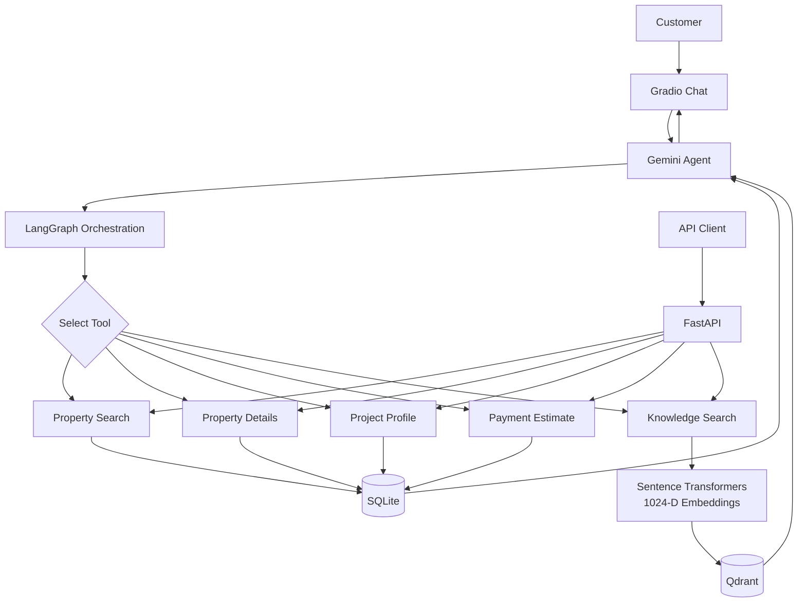

# Real_Estate_GenAI_Agent
Nile Key Properties AI

  
  
  
  
  
  

A bilingual Arabic/English real-estate assistant built with Gemini, LangChain, LangGraph, SQL tools, and RAG. It searches structured property data, retrieves information from a PDF knowledge base, estimates payment plans, and exposes its capabilities through a chat interface and REST API.
Demo data: Nile Key Properties is a fictional training project. Property records, prices, projects, and payment plans are sample data, not real market offers.

Architecture

Implemented Features
Feature	Implementation
Property search	SQLite search with filters for location, project, bedrooms, area, price, and availability
Property details	Exact unit lookup by property ID
Project profile	Project information and registered amenities
Payment estimate	Down payment, remaining balance, monthly installments, and final installment
Knowledge search	PDF text retrieval through embeddings and Qdrant
AI agent	Gemini agent created with LangChain create_agent, backed by a LangGraph execution graph
Bilingual chat	Arabic and English through Gradio
REST API	FastAPI endpoints for property, project, payment, knowledge, and agent chat operations
Observability	Request logging, latency and error tracking, metrics endpoint, and request tracing

Agent Tools
The agent has five registered tools:
Tool	Purpose	Source
search_properties	Search and filter properties	SQLite
get_property_details	Retrieve a unit's full details	SQLite
get_project_profile	Retrieve project profile and amenities	SQLite
get_payment_estimate	Calculate the unit payment plan	SQLite + Python
search_knowledge_base	Retrieve descriptive information and FAQs	Qdrant

LangGraph coordinates the agent flow through the model and tools nodes. The inspected graph contains __start__, model, tools, and __end__.
RAG Pipeline
1. Extract text from the PDF knowledge base using PyMuPDF.
2. Clean and split the text into chunks.
3. Generate 1024-dimensional embeddings with Sentence Transformers.
4. Store and retrieve vectors in the Qdrant collection nile_key_properties.
5. Return ranked passages with source and page metadata to the agent.
Vector configuration: 1024 dimensions · Cosine distance · 27 stored points at the recorded inspection.
Retrieval Optimization Experiment
Dense retrieval was compared with BM25 + Reciprocal Rank Fusion (RRF) on four Arabic/English evaluation queries.
Metric	Dense	Hybrid
Hit@1	0.50	1.00
Hit@3	0.75	1.00
Hit@5	1.00	1.00
MRR	0.675	1.00

FastAPI Endpoints
Method	Endpoint
GET	/health
POST	/api/properties/search
POST	/api/properties/details
POST	/api/projects/profile
POST	/api/payments/estimate
POST	/api/knowledge/search
POST	/api/agent/chat
GET	/api/observability/metrics
GET	/api/observability/traces

Interactive API documentation is available at /docs when the FastAPI server is running.
Observability
- Request and error logging.
- HTTP status and request-latency tracking.
- Metrics inspection endpoint.
- Unique Trace ID and Span ID generation.
- Parent trace propagation.
- Request duration and HTTP status recorded per trace.
- Recent trace inspection, with the latest 100 traces retained.
Evaluation Results
Test	Result
Offline tool evaluation	5 / 5 passed
Risk scenarios	4 / 4 passed
Input validation	18 / 18 passed
Corrected historical agent tests	2 / 2 passed
FastAPI integration tests	5 / 5 passed
Live API and Gradio integration checks	5 / 5 passed
Logging and monitoring checks	Passed
Request tracing checks	Passed

The SQL inspection verified parameterized query values across the four SQL tools, with no unsafe patterns detected in the inspected functions.
Technology Stack
- LLM: Google Gemini Flash Lite
- Agent: LangChain and LangGraph
- Embeddings: Sentence Transformers — 1024 dimensions
- Vector database: Qdrant
- Structured database: SQLite
- Document processing: PyMuPDF
- API: FastAPI, Uvicorn, Pydantic
- Chat UI: Gradio
- Environment: Google Colab
Run in Google Colab
1. Open notebooks/nile_key_properties_agent.ipynb in Google Colab.
2. Add GEMINI_API_KEY, QDRANT_URL, and QDRANT_API_KEY in Colab Secrets.
3. Enable notebook access to those secrets.
4. Run the notebook cells in order and use the Gradio interface or FastAPI endpoints.
API keys are loaded from Colab Secrets and should never be written into the notebook or committed to GitHub.
Repository Structure
Nile-Key-Properties-AI/
├── README.md
├── requirements.txt
├── .gitignore
├── MANIFEST.sha256
├── notebooks/
│   └── nile_key_properties_agent.ipynb
├── data/
│   ├── README.md
│   └── nile_key_properties.sqlite
├── knowledge_base/
│   └── nile_key_knowledge_base.pdf
└── docs/
    ├── ARCHITECTURE.md
    ├── SECRETS.md
    └── TEST_RESULTS.m
